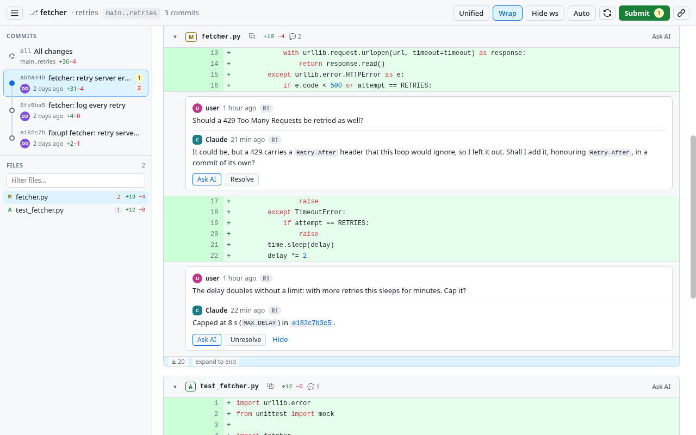
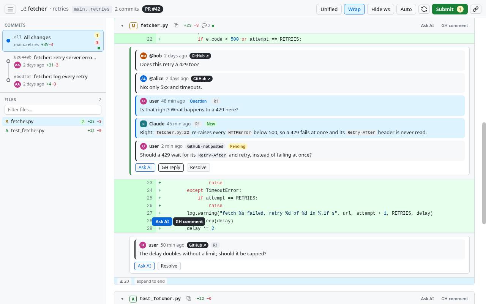

# ccr — Commit Chain Reviewer

ccr is a GitHub-like review page for a chain of git commits, served on your machine. You comment in the browser;
Claude reads every comment from the command line and answers in the same threads.

## Reviewing the commits your agent wrote

Ask Claude to show you the code, or run `/review-commit-series main..HEAD`. Claude starts ccr with a cover letter
describing the change and hands you a URL.

Comment with **Ask AI** on lines, files, commits or the whole change, then click **Submit**: your comments become a
round. Claude fixes the code in new fixup commits and answers every thread, citing the fix or asking back; the page
updates by itself. Repeat until you have nothing left to say. The cover letter becomes the pull-request description.

## Reviewing someone else's pull request

Ask Claude, for example *"review https://github.com/OWNER/REPO/pull/N with ccr"*. Claude checks the pull request out
into a worktree of its own, with its body as the cover letter, so **All changes** is the diff GitHub shows. Claude
changes no code here. A comment is one of two kinds:

* **Ask AI**: a question for Claude, answered in the thread. Nothing goes to GitHub.
* **GH comment**, or **GH reply** in a GitHub thread: a message for the pull request. On Submit, Claude checks it
  against the code and either posts it verbatim into your pending GitHub review or replies with what is wrong with
  it. Questions are answered first. Where GitHub takes no comment, such as a line outside the pull request diff, the
  button is greyed out and its tooltip says why.

The pull request's GitHub discussion comes in too, so you can ask about a GitHub thread or reply to it in place. A
blue background is your exchange with Claude, a grey one what comes from or goes to GitHub, posted or still a draft.
Submitting the review, with its verdict, stays yours, on GitHub.

If you reviewed the pull request before, ccr also opens **Since your last review**: only what the author changed since
then, even after a rebase. Its left side is the version you reviewed; a GH comment on a line removed since goes on the
removed code, where the pull request diff still shows it. Claude can flag lines that need a closer look: an orange
stripe and a ⚑ whose tooltip says why, and **⚑ Next** steps through them.

## Install

Give Claude this:

> Install ccr: `git clone https://github.com/ScyllaPiotr/commit-chain-reviewer.git ~/.claude/skills/ccr`. Check that
> `python3 -c 'import sqlite3, sys; assert sys.version_info >= (3, 10)'` succeeds and that `git --version` is 2.24 or
> newer; for pull requests, also that `gh auth status` shows a login. Then tell me to start a new Claude Code session.

Claude Code loads the clone as a plugin, with the `review-commit-series` skill and the `ccr` command. There is
nothing to build or install.

## More

* [SPEC.md](SPEC.md): how ccr works, from the data model to the HTTP API and the UI.
* [skills/review-commit-series/SKILL.md](skills/review-commit-series/SKILL.md): what Claude does in a review.
* `ccr --help`: the command line.
* ccr listens on 127.0.0.1 only, and every API call needs the session's token. Only `ccr gh-sync` and `ccr gh-post`
  talk to GitHub, through your `gh` login, and neither submits a review.

## License

[MIT](LICENSE). The vendored [highlight.js](https://highlightjs.org/) in `ccr/static/vendor/` is under its own
[BSD 3-Clause License](ccr/static/vendor/LICENSE).
